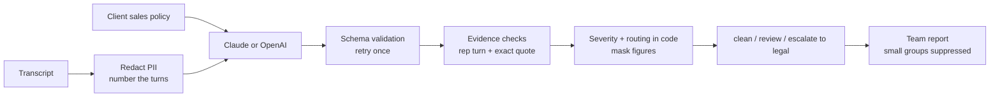

# AI Sales Compliance

Reviews sales call transcripts for **misleading claims** and **improper handling of competitor
pricing**: a rep asking for a rival's confidential quote, using one a customer volunteers,
disclosing another customer's discount, or hinting at coordination with a competitor.

Every finding cites the rep's exact words and the turn they said them in. Severity and routing are
set in code. Competitor and confidential figures are masked in everything the tool outputs.
Findings go to compliance, and coordination risk goes to legal; a person decides.

Runs on Claude or OpenAI behind one interface, with PII redaction, evidence checks, an audit log,
and evals against labelled ground truth.

## Detect and flag, never collect

The tool flags **conversations** where competitor pricing was asked for, received or used. It does
not build a picture of what competitors charge. A competitor-pricing feed built from sales calls
would systematise exactly what the policy forbids. Figures are masked in outputs, and the eval
checks that none leak.

## What it checks

| Finding | Severity | Routed to |
|---|---|---|
| Possible coordination with a competitor | Critical | Legal |
| Rep solicits a competitor's quote, proposal or discount | High | Compliance |
| Rep uses competitor pricing a customer volunteered | High | Compliance |
| Rep discloses another customer's pricing or discount | High | Compliance |
| False statement about a competitor | High | Compliance |
| Absolute guarantee ("zero downtime", "never") | Medium | Compliance |
| Claim not on the approved claims list | Medium | Compliance |
| Misstated prices, terms or support levels | Medium | Compliance |

It also records **good practice**: reps who explicitly decline competitor information.

**Not flagged:** public list prices, a rep saying they *can't* promise something, clearly framed
opinions, and anything the customer says.

The approved claims, commercial terms and competitor list come from the client's policy file
(`data/policy.yaml`), so the same code works for any sales organisation.

## Results

No results are committed yet. Run the evals with your own keys (below), review
`reports/eval_latest.md`, and commit it once you have read every missed and false finding.

All transcripts in this repo are synthetic, for a fictional seller and fictional competitors. Results
show how the pipeline and guardrails behave, not accuracy on real calls. Label 50–100 of the
client's own calls against their policy and re-run before quoting any figure.

## How it works



| Guardrail | What it prevents |
|---|---|
| Quotes must appear as whole words in the cited rep turn; unverifiable findings are marked for a recording check | Accusations without evidence |
| Findings citing customer turns are discarded | Blaming the rep for what the customer said |
| Severity and routing fixed in code | The model escalating or downgrading issues |
| Figures masked in competitor-pricing, disclosure and coordination findings, and in summaries | The tool becoming a store of competitor or customer pricing |
| Reporting by team only; groups under 5 calls suppressed | Individual reps being singled out by the report |
| Failed reviews routed for a manual check | Silent gaps in coverage |
| PII redaction and an audit log without transcript text | Customer data reaching the model or the log |

Full details, including the definitions, schemas, API, eval design and responsible-use notes, are in
**[docs/technical-spec.md](docs/technical-spec.md)**.

## Evals

22 synthetic calls covering all 8 finding types (14 expected findings) and 10 clean calls built to
trip a careless model: an approved 99.9% SLA, a rep refusing to promise zero downtime, a public
list price, a customer repeating a rumour, and reps correctly declining competitor proposals. One
call has a rep decline a competitor proposal and then ask for the discount anyway.

Headline metrics: **finding recall** (a missed breach is the costly error), **clean calls falsely
flagged** (a false finding is an accusation against a rep), and **sensitive figures leaked**
(target zero). The tests prove the leak metric is real: the same perfect fake model leaks figures
when masking is switched off.

## Efficiency (hours)

The eval report estimates QA hours per 100 calls: listening to every call versus spot-checking
clean calls and reviewing only the flagged turns. Manual QA usually samples a small share of calls;
this checks all of them. The minute figures in `config.yaml` are placeholders until measured in a
pilot.

## Quick start

```bash
python3 -m venv .venv && source .venv/bin/activate
pip install -r requirements.txt
cp .env.example .env               # add ANTHROPIC_API_KEY and/or OPENAI_API_KEY
pytest                             # unit and pipeline tests, no API calls

# Evals (real API calls)
python -m evals.run_evals --limit 5               # smoke test
python -m evals.run_evals --provider both         # full Claude vs OpenAI comparison

# Review one call, or a folder of calls with a summary report
python -m sales_compliance review evals/datasets/calls/c07.txt
python -m sales_compliance batch evals/datasets/calls

# Demo API, then open http://localhost:8000/docs
uvicorn sales_compliance.api:app --port 8000
```

Transcript format: one turn per line, `Rep: …` or `Customer: …`, with optional header lines such as
`# team: uk_enterprise`. JSON is also accepted (see the technical spec).

## Adapting it for a client

1. **Policy:** replace `data/policy.yaml` with the client's approved claims, commercial terms and
   competitor list.
2. **Models:** set `models` to the client's licensed models and route through their gateway with
   `ANTHROPIC_BASE_URL` / `OPENAI_BASE_URL`.
3. **Routing:** agree with legal how coordination findings are escalated and documented.
4. **Labels:** label 50–100 of the client's calls in the `build_calls.py` format and re-run.
5. **Governance:** confirm call-recording consent, data protection and any works council
   requirements; keep reporting at team level.
6. **Baselines:** replace the minute figures with timings measured in the pilot.

## Responsible use

This is sales conduct assurance and coaching, not surveillance. Findings are possible issues for a
person to review. They are not determinations, and they should not feed automatically into
performance management.

## Publishing safely

Everything here is synthetic. Before every push:

```bash
PUBLISH_DENYLIST="your employer,client names,project names" python scripts/check_publish.py
```

CI runs the same scan on every push. Never commit real call transcripts or results.

## Project structure

```
sales_compliance/
  schemas.py        finding types with severity and routing, input and model-output schemas
  analyze.py        prompt, evidence checks, masking, outcome
  aggregate.py      batch report by team with suppression
  policy.py         loads the client's sales policy
  runner.py         audited single and batch entry points
  io.py             .txt / .json transcript loading
  engine.py         guardrails + validated JSON calls with retry
  providers.py      Claude, OpenAI and fake providers
  guardrails.py     PII redaction, size limits, figure masking
  audit.py          JSONL audit log
  api.py            FastAPI demo
  __main__.py       CLI
data/policy.yaml    sales policy for the fictional seller
evals/              call generator, labelled transcripts, scoring, eval runner
docs/               technical specification
scripts/            pre-publish safety scan
tests/              unit, pipeline, API, dataset integrity, publish safety
```
