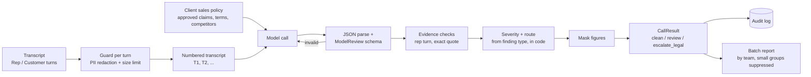

# Technical specification

Sales call transcript in; possible compliance findings out, each citing a rep turn and a verified
quote, with severity and routing set in code. Competitor and confidential figures are masked in
everything the tool outputs.

## Scope: detect and flag, never collect

The tool flags **conversations** in which competitor pricing was asked for, received or used. It does
not extract, store or aggregate what competitors charge. Building a competitor-pricing feed from sales
calls would turn one rep's lapse into an organised system for holding improperly obtained information,
which is the exposure the policy exists to prevent. Accordingly:

- money amounts and percentages are masked in quotes and explanations of competitor-pricing,
  confidential-disclosure and coordination findings, and in every summary;
- outputs report finding types and turn numbers, never price tables;
- the eval measures leaks of sensitive figures, and the target is zero.

## Pipeline



## Finding types

| Type | Category | Severity | Route | What it covers |
|---|---|---|---|---|
| `possible_coordination` | competition_law | critical | legal | Any suggestion of contact, agreement or understanding with a competitor on prices, discounts, customers or territories |
| `solicited_competitor_pricing` | competitor_information | high | compliance | Rep asks for a competitor's quote, proposal, prices or discount, in any form |
| `used_volunteered_competitor_pricing` | competitor_information | high | compliance | Customer offers competitor pricing; rep asks for more, asks for the document, or builds an offer on it |
| `confidential_disclosure` | confidential_information | high | compliance | Rep reveals another customer's prices, discounts or terms |
| `false_competitor_statement` | misleading_claim | high | compliance | Unsupported negative statement of fact about a competitor |
| `absolute_guarantee` | misleading_claim | medium | compliance | Outcome promised as certain ("guaranteed", "never", "zero downtime") |
| `unapproved_claim` | misleading_claim | medium | compliance | Product or certification claim not on the approved list, or materially stronger |
| `misstated_terms` | misleading_claim | medium | compliance | Prices, contract terms, support levels or discount authority that contradict the policy |

**Good practice** (recorded, not flagged): `declined_competitor_information`, where the rep explicitly
declines competitor pricing the customer offers.

**Not findings:** a competitor's publicly listed price; a rep saying they cannot promise something;
clearly framed personal opinions; anything said by the customer.

Severity and route come from this table in `schemas.py`. The model only identifies the type, turn
and quote.

## Evidence rules

| Check | Outcome |
|---|---|
| Finding cites a customer turn | Discarded and counted (customers' statements are never findings against the rep) |
| Quote is not found, as whole words, in the cited rep turn | Finding kept, marked `evidence_verified: false`, review reason "check the recording" |
| Turn number out of range | Treated as unverified |
| Same type at the same turn twice | Deduplicated |
| Good-practice item not a verified rep quote | Dropped |

Call outcome: `escalate_legal` if any finding routes to legal; `review` if any other finding;
`clean` otherwise; `error` if the review failed (routed for a manual check, never dropped).

## Stack

| Layer | Component |
|---|---|
| Input | `Call`: `id`, `segments` (team, region; never individual reps), `turns` (`rep` / `customer`) |
| File loading | `.txt` (`Rep:` / `Customer:` lines, `# team: …` headers, continuation lines) or `.json`; a folder loads every call in it |
| Policy | `data/policy.yaml`: company, approved claims, commercial terms, competitors; rendered into the prompt |
| Guardrails | PII redaction per turn (emails, phones, cards, IBANs, labelled account numbers and sort codes); 40,000-character limit per transcript |
| Model | Claude or OpenAI behind one provider interface |
| Schema | `ModelReview` (Pydantic): finding and good-practice types are closed lists; labels normalised; one retry on invalid output |
| Post-processing | `analyze.review_call`: evidence checks, severity and routing, masking, outcome |
| Reporting | `aggregate.summarise` / `render_markdown`: outcomes, findings by type, routing lists, team breakdown with suppression below 5 calls |
| Audit | JSONL per call: model, tokens, latency, attempts, redactions, outcome, finding types. No transcript text unless enabled |
| Interfaces | CLI `review` / `batch`; API `/v1/review-call`, `/v1/review-batch` |

## Output: per call

```json
{
  "id": "c07",
  "status": "ok",
  "outcome": "review",
  "summary": "Customer shared a competitor quote; the rep asked for the document and offered to undercut it.",
  "findings": [
    {
      "type": "used_volunteered_competitor_pricing",
      "category": "competitor_information",
      "severity": "high",
      "route": "compliance",
      "turn": 2,
      "quote": "[FIGURE] with [FIGURE] off. What else was in their offer? Send me the PDF and I'll go below it.",
      "explanation": "The rep asked for the competitor's document and offered to beat its pricing.",
      "evidence_verified": true
    }
  ],
  "good_practice": [],
  "unverified_findings": 0,
  "dropped_findings": 0,
  "redactions": {},
  "segments": {"team": "uk_midmarket"},
  "review_reasons": ["High: used volunteered competitor pricing at T2"]
}
```

Shape exact, values illustrative.

## API

```bash
curl -X POST http://localhost:8000/v1/review-call \
  -H "Content-Type: application/json" \
  -d '{"id": "x1", "segments": {"team": "uk_enterprise"},
       "turns": [{"speaker": "customer", "text": "Brightwave sent their proposal."},
                 {"speaker": "rep", "text": "Forward it to me and I will beat it."}]}'
```

`/v1/review-batch` takes `{"calls": [...]}` (up to `analysis.max_batch`, unique ids) and returns the
batch summary plus per-call results. Errors: 400 duplicate ids, 401 missing API key (when
`DEMO_API_KEY` is set), 413 batch too large, 503 provider not configured.

## Evaluation

| Item | Detail |
|---|---|
| Dataset | 22 synthetic B2B sales calls for the fictional seller Northstar Cloud, generated with labels by `evals/datasets/build_calls.py` (each target turn is tagged in code, so labels cannot drift) |
| Teams | uk_enterprise 9, uk_midmarket 9, emea_partners 4 (suppressed in reports) |
| Expected findings | 14 across all 8 types: solicitation 4, guarantee 2, confidential disclosure 2, misstated terms 2, unapproved claim 1, false competitor statement 1, use of volunteered pricing 1, coordination 1 |
| Clean calls | 10, including traps: an approved 99.9% SLA (not a guarantee); a rep saying "I can't promise zero downtime"; a public list price; a customer repeating a rumour the rep declines to discuss; a personal opinion; a customer quoting a competitor price that the rep ignores; two reps correctly declining competitor proposals |
| Mixed call | c22: the rep declines a competitor proposal, then asks for the discount percentage (good practice and a finding in one call) |
| Matching | A predicted finding matches when type and turn both match |
| Headline metrics | Finding recall (overall and per category), finding precision, **clean calls falsely flagged** |
| Guardrail metrics | **Sensitive figures leaked in output** (target 0), unverified findings, customer-turn findings discarded, errors |
| Integrity tests | Every labelled turn is a rep turn; every finding type has an example; sensitive figures appear in their transcripts; a perfect model scores 100% with zero leaks; **the same perfect model leaks figures when masking is switched off**, proving the leak metric works; a model that never flags gets 0% recall; a model that flags every call is penalised on clean calls |

## Efficiency (hours)

QA hours per 100 calls: listening to and scoring every call (`baseline_minutes.call_qa`, assumed 30
minutes) versus spot-checking clean calls (1 minute) and reviewing the cited turns of flagged calls
(10 minutes); failed calls get a full listen. Model time is machine time and is not counted. Coverage
changes too: manual QA usually samples a small share of calls, while this checks all of them.

All minute figures are assumptions until measured in a pilot.

## Configuration

| Key | Default | Purpose |
|---|---|---|
| `provider`, `models.*` | anthropic; `claude-sonnet-5-5` / `gpt-5` | Set to the models your licence covers |
| `policy.path` | `data/policy.yaml` | The client's sales policy |
| `guardrails.redact_pii` / `max_input_chars` | `true` / 40000 | Redaction and transcript size limit |
| `audit.log_content` | `false` | Keep transcripts out of the audit log |
| `analysis.max_workers` / `min_group_size` / `max_batch` | 4 / 5 / 200 | Parallelism, group suppression, API batch limit |
| `baseline_minutes`, `review_minutes` | 30 / 1 / 10 | Hours estimate (assumptions) |

## Limitations and responsible use

- **Possible issues, not determinations.** Every finding is reviewed by compliance; coordination
  findings go to legal. Legal may want to control how competition-law matters are handled and
  documented; agree the routing with them before go-live.
- **Not a disciplinary tool.** Report by team, not by named rep; do not feed findings automatically
  into performance management. Expect requirements around call-recording consent, data protection,
  and works council consultation where applicable.
- **Absence is not evidence.** The tool reports what was said. It does not prove that a required
  statement was never made elsewhere (in email or a follow-up call).
- **Transcription quality matters.** Speech-to-text errors can create or hide findings. The eval set
  uses clean synthetic transcripts.
- **Masking is pattern-based.** It covers currency amounts, percentages and per-unit prices; figures
  written entirely in words ("half our list price") are not masked.
- **English only** in the eval set.

## Files

`sales_compliance/schemas.py` · `sales_compliance/analyze.py` · `sales_compliance/aggregate.py` ·
`sales_compliance/policy.py` · `data/policy.yaml` · `evals/datasets/build_calls.py` ·
`evals/metrics.py` · `evals/run_evals.py`
